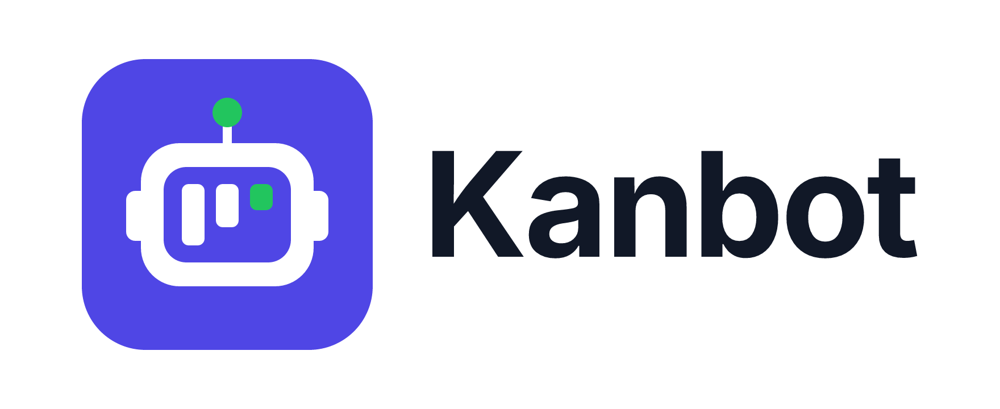

<p align="center"></p>

# Kanbot

> **Your sprint board with an AI teammate.** A personal todo app built around agile sprints (backlog → sprint → board) with a simple AI assistant that writes todos, plans sprints and summarises them.

A full-stack Kanban and sprint-planning app with a React client and an Express API.

| Folder | Status | What it is |
|---|---|---|
| [`server/`](server/) | ✅ Complete | Express 5 + TypeScript API: auth (JWT), projects, backlog, sprints, board, AI assistant (mock or real LLM) |
| [`client/`](client/) | ✅ Implemented | React + TypeScript + Vite client with backlog, projects, sprints, board, and AI workflows |
| [`docs/`](docs/) | 📄 | Requirements and implementation plan, in English and Arabic |
| [`design/`](design/) | 🎨 | Low-fidelity wireframes (no visual design) + logo |

## Documents

| | English | العربية |
|---|---|---|
| Requirements | [REQUIREMENTS.en.md](docs/REQUIREMENTS.en.md) | [REQUIREMENTS.ar.md](docs/REQUIREMENTS.ar.md) |
| Implementation plan + API design | [IMPLEMENTATION-PLAN.en.md](docs/IMPLEMENTATION-PLAN.en.md) | [IMPLEMENTATION-PLAN.ar.md](docs/IMPLEMENTATION-PLAN.ar.md) |

API contract (all request and response types): [`server/src/types/api.ts`](server/src/types/api.ts)

## Deployment

Deployment templates for Netlify (client), Render (API), and Neon PostgreSQL (persistent data) are included. See [`DEPLOYMENT.ar.md`](DEPLOYMENT.ar.md) for manual GitHub upload and deployment steps.

## Quick start

```bash
cd server
npm install
cp .env.example .env   # AI runs in free mock mode until you add AI_API_KEY
npm run seed           # demo@kanbot.dev / password123
npm run dev            # → http://localhost:4000/api/health
```

In a second terminal:

```bash
cd client
npm install
npm run dev            # → http://localhost:5173
```

The API uses Mock AI by default. Configure a provider only in `server/.env`; never expose its key through client environment variables. For all setup options, design decisions, implemented scope, limitations, and checks, see [`client/README.md`](client/README.md). The short end-to-end demo is documented in [`client/DEMO-SCRIPT.md`](client/DEMO-SCRIPT.md).

## Design

- `design/wireframes/*.png`: 12 greyscale wireframes (flow + 11 screens). They show **content and layout only**. Colours, typography and components are up to you.
- `design/logo/`: icon and logo (SVG + PNG, light and dark). Use them, recolour them, or make your own.
- `design/kanbot.figcraft` (source) and `design/kanbot.fig` (experimental Figma export).
