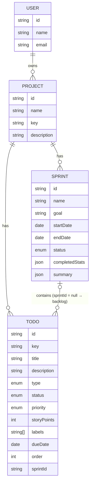

<div dir="rtl">

# Kanbot: خطة التنفيذ (AR)

English version: [IMPLEMENTATION-PLAN.en.md](IMPLEMENTATION-PLAN.en.md)

> كيف تبني الواجهة الأمامية لـ Kanbot في **7 أيام**: الإعداد، والبنية المعمارية، و**واجهة برمجة التطبيقات (API) الكاملة للخادم**، وخطة يومًا بيوم.
> اقرأ [المتطلبات](REQUIREMENTS.ar.md) أولًا. معرّفات المتطلبات (AUTH-1، BL-3، AI-2…) تشير إلى تلك الوثيقة.

| | |
|---|---|
| **الواجهة الأمامية (أنت تبنيها)** | `kanbot/client`: React + TypeScript + Vite |
| **الخادم (جاهز، لا تغيّره)** | `kanbot/server`: Express 5 + TypeScript على `http://localhost:4000/api` |
| **عقد الـ API** | [`server/src/types/api.ts`](../server/src/types/api.ts): انسخه إلى `client/src/types/api.ts` |
| **الحساب التجريبي** | `demo@kanbot.dev` / `password123` (بعد تشغيل `npm run seed`) |

---

## 1. تشغيل الخادم

```bash
cd kanbot/server
npm install
cp .env.example .env      # works as-is: the AI runs in mock mode
npm run seed              # demo user + a project with sprints and todos (resets the DB)
npm run dev               # → http://localhost:4000/api/health
npm run smoke             # optional: tests every endpoint on a throwaway DB
```

### 1.1 الذكاء الاصطناعي: وضع المحاكاة (mock) أو الحقيقي
- **المحاكاة (الافتراضي).** عندما يكون `AI_API_KEY` فارغًا، يجيب مساعد مدمج قائم على القواعد فورًا، ومجانًا، ودون اتصال بالإنترنت. كل نقطة نهاية (endpoint) للذكاء الاصطناعي تُرجع نفس شكل الـ JSON كما مع نموذج حقيقي، مع `"source": "mock"`. ابنِ التطبيق كاملًا في وضع المحاكاة.
- **الحقيقي.** ضع مفتاحًا من مزوّد مجاني في `.env`. يتواصل الخادم مع أي API متوافقة مع OpenAI:

  ```env
  AI_API_KEY=<your key>
  AI_BASE_URL=https://openrouter.ai/api/v1     # or Groq / Gemini / Ollama, see .env.example
  AI_MODEL=<model id>
  ```
  أعد تشغيل الخادم. الآن يُرجع `GET /api/ai/status` القيمة `{ "mode": "ai", "model": "…" }`.

تُخزَّن البيانات في `server/data/db.json` (ملف JSON). احذفه أو شغّل `npm run seed` للبدء من جديد.

---

## 2. التقنيات المستخدمة

| الجانب | إلزامي | مُوصى به (يمكنك اختيار غيره) |
|---|---|---|
| إطار العمل | React 19 + TypeScript (strict) + Vite | n/a |
| التوجيه (Routing) | React Router | n/a |
| حالة الخادم (Server state) | n/a | **TanStack Query**: التخزين المؤقت، وحالات التحميل/الخطأ، والتحديثات المتفائلة (optimistic updates)، والإبطال (invalidation) |
| النماذج (Forms) | n/a | **react-hook-form + zod** (`@hookform/resolvers`) |
| السحب والإفلات | n/a | **dnd-kit** (`@dnd-kit/core`، `@dnd-kit/sortable`): سهل الوصول (accessible)، ويدعم لوحة المفاتيح |
| Markdown (ردود الذكاء الاصطناعي) | n/a | **react-markdown** (يبقى HTML الخام معطّلًا) |
| التواريخ | n/a | **date-fns** أو `Intl.DateTimeFormat` |
| مكتبة الواجهة / التنسيق | **اختيارك**: لا يوجد تصميم جاهز. | مثل MUI، أو shadcn/ui + Tailwind، أو Mantine، أو Chakra، أو Ant Design، أو CSS Modules عادية |
| الأيقونات | اختيارك | lucide-react، أو أيقونات MUI، أو Tabler… |

اكتب اختياراتك وأسبابها في `client/README.md`.

```bash
cd kanbot
npm create vite@latest client -- --template react-ts
cd client
npm i react-router @tanstack/react-query react-hook-form zod @hookform/resolvers \
      @dnd-kit/core @dnd-kit/sortable @dnd-kit/utilities react-markdown date-fns
cp ../server/src/types/api.ts src/types/api.ts
```

أضف `VITE_API_URL=http://localhost:4000/api` إلى `client/.env`.

---

## 3. بنية الواجهة الأمامية

### 3.1 المسارات (Routes)

| المسار | الصفحة | الحماية (Guard) |
|---|---|---|
| `/login` | تسجيل الدخول | للزوّار فقط |
| `/register` | إنشاء حساب | للزوّار فقط |
| `/` | ← إعادة توجيه إلى `/projects` | خاص |
| `/projects` | قائمة المشاريع | خاص |
| `/projects/:projectId` | ← إعادة توجيه إلى `backlog` | خاص |
| `/projects/:projectId/backlog` | قائمة المهام المؤجلة (Backlog) + السبرنتات (Sprints) المخطط لها | خاص |
| `/projects/:projectId/board` | لوحة السبرنت النشط | خاص |
| `/projects/:projectId/sprints` | سجل السبرنتات | خاص |
| `/projects/:projectId/sprints/:sprintId` | تفاصيل السبرنت + الملخص | خاص |
| `*` | غير موجود | n/a |

استخدم مسار تخطيط (layout route) واحدًا للصفحات الخاصة (`<ProtectedRoute>` ← `<AppShell>` مع شريط جانبي + شريط علوي + درج الذكاء الاصطناعي) وآخر لصفحات الزوّار (`<GuestRoute>`).

### 3.2 هيكل المجلدات (مقترح)

```
client/src/
├── main.tsx                 # المزوّدات: QueryClient، Router، Auth، Theme، Toasts
├── router.tsx               # جدول المسارات (§3.1)
├── types/api.ts             # منسوخ من الخادم — لا تعدّله يدويًا أبدًا
├── api/
│   ├── client.ts            # غلاف fetch: الرابط الأساسي، التوكن، JSON، ApiError، معالجة 401
│   ├── auth.ts              # register(), login(), me()
│   ├── projects.ts          # listProjects(), createProject()...
│   ├── todos.ts
│   ├── sprints.ts
│   └── ai.ts
├── hooks/                   # خطافات TanStack Query: useProjects(), useBacklog(), useMoveTodo()...
├── features/
│   ├── auth/                # LoginPage, RegisterPage, AuthProvider, ProtectedRoute, GuestRoute
│   ├── projects/            # ProjectsPage, ProjectFormDialog, ProjectSwitcher
│   ├── backlog/             # BacklogPage, TodoRow, QuickCreate, SprintSection, Filters
│   ├── board/               # BoardPage, Column, TodoCard, SprintProgress, CompleteSprintDialog
│   ├── sprints/             # SprintsPage, SprintDetails, StartSprintDialog, SprintFormDialog
│   ├── todos/               # TodoDetailsDialog, PriorityBadge, PointsSelect, TypeIcon
│   └── ai/                  # AssistantDrawer, ChatMessages, GenerateTodosDialog, PlanSprintDialog, SprintSummary
├── components/              # مكوّنات نظام التصميم الخاص بك: Button, Dialog, EmptyState, ErrorState, ConfirmDialog...
└── lib/                     # formatDate(), cn()، ثوابت (تسميات الحالات/الأولويات)
```

### 3.3 عميل الـ API والأخطاء
دالة واحدة `request<T>(method, path, body?)` تستخدمها كل ملفات `api/*.ts`:
1. أضف البادئة `import.meta.env.VITE_API_URL`، وأضف `Content-Type: application/json` و`Authorization: Bearer <token>` عند وجود توكن.
2. `204` ← أرجع `undefined`.
3. استجابة غير 2xx ← ارمِ صنف `ApiError` يحتوي على `status` و`code` و`message` و`details` من `ApiErrorBody`.
4. `401` على أي مسار عدا `/auth/login` ← استدعِ دالة `onUnauthorized()` التي يسجّلها AuthProvider (امسح الجلسة، وأعد التوجيه إلى `/login?redirect=…`، واعرض "انتهت الجلسة") (AUTH-6).
5. فشل الشبكة ← ارمِ `ApiError` بالرمز `NETWORK_ERROR` والرسالة "Cannot reach the server. Is it running?".

دالة مساعدة: `fieldErrors(err)` تحوّل `details[]` إلى `{ [field]: message }` لكي تتمكن النماذج من استدعاء `setError` لكل حقل.

### 3.4 قواعد الحالة (State)
- **بيانات الخادم تعيش في TanStack Query فقط** (لا نسخ منها في `useState`/context). التوكن والمستخدم يعيشان في AuthProvider (+ `localStorage` للتوكن).
- مفاتيح الاستعلامات (Query keys):
  `['projects']`، `['project', id]`، `['todos', projectId, filters]`، `['board', sprintId]`، `['sprints', projectId]`، `['sprint', sprintId]`، `['ai-status']`.
- بعد أي تعديل (mutation)، **أبطِل (invalidate)** ما تغيّر. مثلًا، إكمال سبرنت يُبطل `['sprints', projectId]` و`['board', sprintId]` و`['todos', projectId]` و`['project', projectId]`.
- **التحديثات المتفائلة** للنقل/إعادة الترتيب (BL-5، SPR-5): في `onMutate`، ألغِ الاستعلامات، والتقط نسخة (snapshot)، وحدّث الذاكرة المؤقتة (cache)؛ في `onError`، استعد النسخة واعرض إشعارًا (toast)؛ في `onSettled`، أبطِل.
- الحالة الخاصة بالواجهة فقط (فتح نافذة حوار، رسائل المحادثة، الفلاتر) تبقى في المكوّنات أو في context صغير. يمكن أن تعيش الفلاتر في الرابط (`?q=&priority=`).
- عند تسجيل الخروج: `queryClient.clear()`.

### 3.5 نموذج السحب والإفلات
- قائمة المهام المؤجلة **قائمة واحدة**. كل سبرنت مخطط له قائمة. اللوحة فيها **قائمة لكل حالة**.
- بعد الإفلات، استدعِ `POST /todos/:id/move` مع `{ sprintId?, status?, position }`. القيمة `position` هي **الفهرس في القائمة الهدف بعد إزالة المهمة المسحوبة** (0 = الأعلى). الخادم يعيد ترقيم `order` نيابةً عنك. لا تحسب `order` بنفسك أبدًا.
- الواجهة المتفائلة: أزل المهمة من المصفوفة المصدر في الذاكرة المؤقتة وأدرجها عند `position` في المصفوفة الهدف.

---

## 4. تصميم واجهة برمجة تطبيقات الخادم (Backend API)

الرابط الأساسي `http://localhost:4000/api`. JSON في الإدخال والإخراج. كل المسارات عدا `health` و`auth/register` و`auth/login` تتطلب `Authorization: Bearer <token>`. لا يستطيع المستخدمون الوصول إلا إلى بياناتهم. معرّفات مستخدم آخر تُرجع **404**، وليس 403 أبدًا.

### 4.1 نموذج البيانات



**القيم المعدّدة (Enums)**

| الحقل | القيم |
|---|---|
| `Todo.status` | `todo` · `in_progress` · `in_review` · `done` (ترتيب أعمدة اللوحة) |
| `Todo.priority` | `low` · `medium` · `high` · `urgent` |
| `Todo.type` | `task` · `story` · `bug` |
| `Todo.storyPoints` | `1` · `2` · `3` · `5` · `8` · `13` · `null` |
| `Sprint.status` | `planned` ← `active` ← `completed` |

**قواعد العمل**
- المهمة التي لها `sprintId: null` موجودة في **قائمة المهام المؤجلة**. يُعيَّن `key` (`KAN-12`) عند الإنشاء ولا يتغيّر أبدًا.
- `order` هو الموضع داخل قائمتها: قائمة المهام المؤجلة، أو *عمود حالة واحد في سبرنت واحد*. تُرجَع القوائم مرتّبة.
- يُعيَّن `completedAt` عندما تصبح الحالة `done`، ويُمسح عندما تغادر `done`.
- **سبرنت نشط واحد** على الأكثر لكل مشروع. السبرنتات **المخطط لها (planned)** فقط يمكن بدؤها، أو تعديلها بحرية، أو حذفها (الحذف يعيد مهامها إلى قائمة المهام المؤجلة).
- إكمال السبرنت: المهام المنجزة تبقى فيه (للسجل). المهام غير المنتهية تنتقل إلى قائمة المهام المؤجلة أو إلى سبرنت مخطط له، مع الاحتفاظ بحالتها. تُحفظ لقطة في `completedStats` (مع `carriedOver`). لا يمكن نقل مهام سبرنت مكتمل (409).
- لا يمكن إضافة مهام إلى سبرنت مكتمل (409).
- `Sprint.stats` محدّثة دائمًا بشكل حي (محسوبة من المهام الموجودة فيه حاليًا). للسبرنتات المكتملة، اعرض `completedStats`.

### 4.2 الأخطاء

```json
{ "error": { "code": "VALIDATION_ERROR", "message": "email: Enter a valid email address",
             "details": [{ "path": "email", "message": "Enter a valid email address" }] } }
```

| الحالة | `code` | متى | سلوك الواجهة |
|---|---|---|---|
| 400 | `VALIDATION_ERROR` | جسم الطلب/الاستعلام غير صالح. `details[].path` = اسم الحقل | اعرضه تحت الحقول؛ وإلا فإشعار بالرسالة `message` |
| 401 | `UNAUTHORIZED` | التوكن مفقود/منتهي؛ بيانات دخول خاطئة عند تسجيل الدخول | تسجيل الدخول: اعرض الرسالة. في غير ذلك: مسار انتهاء الجلسة |
| 404 | `NOT_FOUND` | مسار أو معرّف غير معروف، أو ليس ملكك | حالة "غير موجود" |
| 409 | `CONFLICT` | البريد مستخدم، المفتاح مستخدم، سبرنت نشط بالفعل، سبرنت مكتمل… | اعرض `message` |
| 429 | `RATE_LIMITED` | المصادقة: 50 / 15 دقيقة. الذكاء الاصطناعي: 20 / دقيقة لكل مستخدم | اعرض `message`، واسمح بإعادة المحاولة لاحقًا |
| 502 | `AI_ERROR` | فشل مزوّد الذكاء الاصطناعي / إجابة غير صالحة / انتهاء المهلة | اعرض `message` + "حاول مجددًا" |
| 500 | `INTERNAL_ERROR` | خلل برمجي (Bug) | خطأ عام |

### 4.3 ملخص نقاط النهاية (Endpoints)

| الطريقة | المسار | الجسم ← الاستجابة | المتطلب |
|---|---|---|---|
| GET | `/health` | ← `HealthResponse` | n/a |
| **المصادقة (Auth)** |||
| POST | `/auth/register` | `RegisterRequest` ← **201** `AuthResponse` | AUTH-1 |
| POST | `/auth/login` | `LoginRequest` ← `AuthResponse` | AUTH-2 |
| GET | `/auth/me` | ← `{ user }` | AUTH-3 |
| **المشاريع (Projects)** |||
| GET | `/projects` | ← `{ projects: ProjectWithStats[] }` (الأحدث تحديثًا أولًا) | PRJ-1 |
| POST | `/projects` | `CreateProjectRequest` ← **201** `{ project }` | PRJ-2 |
| GET | `/projects/:projectId` | ← `{ project: ProjectWithStats }` | PRJ-5 |
| PATCH | `/projects/:projectId` | `UpdateProjectRequest` ← `{ project }` | PRJ-3 |
| DELETE | `/projects/:projectId` | ← **204** (يحذف سبرنتاته ومهامه) | PRJ-4 |
| **المهام (Todos)** |||
| GET | `/projects/:projectId/todos?sprintId=&status=&priority=&type=&search=` | ← `{ todos }` | BL-1، BL-6 |
| POST | `/projects/:projectId/todos` | `CreateTodoRequest` ← **201** `{ todo }` | BL-2 |
| POST | `/projects/:projectId/todos/bulk` | `{ todos: CreateTodoRequest[] }` ← **201** `{ todos }` | AI-2 |
| GET | `/todos/:todoId` | ← `{ todo }` | BL-3 |
| PATCH | `/todos/:todoId` | `UpdateTodoRequest` ← `{ todo }` | BL-3، BL-7 |
| POST | `/todos/:todoId/move` | `MoveTodoRequest` ← `{ todo }` | BL-5، SPR-5 |
| DELETE | `/todos/:todoId` | ← **204** | BL-4 |
| **السبرنتات (Sprints)** |||
| GET | `/projects/:projectId/sprints` | ← `{ sprints }` (النشط، ثم المخطط لها، ثم المكتملة من الأحدث) | SPR-7 |
| POST | `/projects/:projectId/sprints` | `CreateSprintRequest` ← **201** `{ sprint }` | SPR-1، AI-3 |
| GET | `/sprints/:sprintId` | ← `{ sprint }` | SPR-7 |
| GET | `/sprints/:sprintId/todos` | ← `SprintBoardResponse` `{ sprint, columns }` | SPR-4 |
| PATCH | `/sprints/:sprintId` | `UpdateSprintRequest` ← `{ sprint }` | SPR-2 |
| DELETE | `/sprints/:sprintId` | ← **204** (المخطط لها فقط) | SPR-2 |
| POST | `/sprints/:sprintId/start` | `StartSprintRequest` ← `{ sprint }` | SPR-3 |
| POST | `/sprints/:sprintId/complete` | `CompleteSprintRequest` ← `{ sprint }` | SPR-6 |
| **الذكاء الاصطناعي (AI)** |||
| GET | `/ai/status` | ← `{ mode: 'mock' \| 'ai', model }` | AI-5 |
| POST | `/projects/:projectId/ai/chat` | `ChatRequest` ← `ChatResponse` | AI-1 |
| POST | `/projects/:projectId/ai/generate-todos` | `GenerateTodosRequest` ← `GenerateTodosResponse` | AI-2 |
| POST | `/projects/:projectId/ai/plan-sprint` | `PlanSprintRequest` ← `PlanSprintResponse` | AI-3 |
| POST | `/sprints/:sprintId/ai/summary` | ← `SprintSummaryResponse` (يُحفظ على السبرنت) | AI-4 |

### 4.4 تفاصيل نقاط النهاية وأمثلة

#### المصادقة (Auth)
```http
POST /api/auth/register
{ "name": "Sara", "email": "sara@example.com", "password": "password123" }

201 { "token": "eyJhbGciOi…", "user": { "id": "…", "name": "Sara", "email": "sara@example.com", "createdAt": "…" } }
409 { "error": { "code": "CONFLICT", "message": "An account with this email already exists.",
                 "details": [{ "path": "email", "message": "An account with this email already exists." }] } }
```
يُرجع `POST /auth/login` نفس الجسم مع 200، أو 401 مع `"Incorrect email or password."`. يُرجع `GET /auth/me` القيمة `{ "user": … }`. صلاحية التوكن 7 أيام. تسجيل الخروج يتم في جهة العميل فقط (انسَ التوكن).

#### المشاريع (Projects)
```http
POST /api/projects
{ "name": "Mobile App Redesign", "description": "New look" }       // المفتاح key اختياري → "MAR"

201 { "project": { "id": "…", "name": "Mobile App Redesign", "key": "MAR", "description": "New look",
      "createdAt": "…", "updatedAt": "…",
      "stats": { "backlogCount": 0, "totalTodos": 0, "activeSprint": null } } }
```
`key`: من 2 إلى 6 أحرف، يحوّلها الخادم إلى أحرف كبيرة، وفريد لكل مستخدم (409 مع `details[0].path = "key"`).

#### المهام (Todos)
```http
POST /api/projects/:projectId/todos
{ "title": "Login screen", "priority": "high", "storyPoints": 3 }

201 { "todo": { "id": "…", "projectId": "…", "sprintId": null, "key": "MAR-1", "title": "Login screen",
      "description": "", "type": "task", "status": "todo", "priority": "high", "storyPoints": 3,
      "labels": [], "dueDate": null, "order": 0, "createdAt": "…", "updatedAt": "…", "completedAt": null } }
```
القيم الافتراضية: `type: task`، `status: todo`، `priority: medium`، `storyPoints: null`، `sprintId: null`. المهام الجديدة تُضاف إلى **نهاية** قائمتها.

**العرض / التصفية**: `GET /projects/:id/todos?sprintId=backlog` يُرجع قائمة المهام المؤجلة مرتّبة حسب `order`. `sprintId=<id>` يُرجع سبرنتًا واحدًا. أضف `search` و`priority` و`type` و`status` حسب الحاجة.

**التحديث**: `PATCH /todos/:id` مع أي مجموعة جزئية من الحقول. إذا تغيّر `sprintId` أو `status` (داخل سبرنت)، تُلحق المهمة بنهاية القائمة الجديدة.

**النقل (السحب والإفلات)**:
```http
POST /api/todos/:todoId/move
{ "status": "in_progress", "position": 0 }                    // اللوحة: إلى أعلى عمود "In Progress"
{ "position": 3 }                                             // قائمة المهام المؤجلة: إعادة ترتيب
{ "sprintId": "<sprint id>", "status": "todo", "position": 0 } // قائمة المهام المؤجلة → سبرنت
{ "sprintId": null, "position": 0 }                           // سبرنت → أعلى قائمة المهام المؤجلة
```

#### السبرنتات (Sprints)
```http
POST /api/projects/:projectId/sprints
{ "goal": "Auth flow", "todoIds": ["<backlog todo id>", "…"] }  // كل الحقول اختيارية

201 { "sprint": { "id": "…", "projectId": "…", "name": "Sprint 1", "goal": "Auth flow",
      "startDate": null, "endDate": null, "status": "planned", "startedAt": null, "completedAt": null,
      "completedStats": null, "summary": null,
      "stats": { "totalTodos": 2, "doneTodos": 0, "totalPoints": 8, "donePoints": 0,
                 "byStatus": { "todo": 2, "in_progress": 0, "in_review": 0, "done": 0 } },
      "createdAt": "…", "updatedAt": "…" } }
```
يجب أن تكون كل `todoIds` مهامًا من قائمة المهام المؤجلة للمشروع (وإلا 400).

```http
POST /api/sprints/:id/start      { "startDate": "2026-11-02", "endDate": "2026-11-16" }  // كلاهما اختياري
POST /api/sprints/:id/complete   { "moveUnfinishedTo": "backlog" }   // أو معرّف سبرنت مخطط له
GET  /api/sprints/:id/todos      → { "sprint": {…}, "columns": { "todo": [], "in_progress": [], "in_review": [], "done": [] } }
```
بعد `complete`، تكون `sprint.completedStats` = `{ totalTodos, doneTodos, totalPoints, donePoints, byStatus, carriedOver }`.

#### الذكاء الاصطناعي (AI)
كل نقاط نهاية الذكاء الاصطناعي طلب/استجابة عادية (دون بثّ streaming)، وتستغرق من 1 إلى 10 ثوانٍ مع نموذج حقيقي (فورية في وضع المحاكاة)، وتتضمن `"source": "mock" | "ai"`.

```http
POST /api/projects/:projectId/ai/generate-todos
{ "prompt": "User profile page with avatar upload", "count": 5 }

200 { "source": "ai", "todos": [
  { "title": "Design the profile page layout", "description": "…", "type": "task", "priority": "high", "storyPoints": 2 },
  … ] }
```
لا يُحفظ شيء. احفظ المهام التي يحتفظ بها المستخدم عبر `POST /projects/:id/todos/bulk`. (نصيحة لوضع المحاكاة: الطلب الذي يحتوي عنصرًا واحدًا في كل سطر يتحوّل إلى مهمة لكل سطر.)

```http
POST /api/projects/:projectId/ai/plan-sprint
{ "capacity": 20, "focus": "AI features" }

200 { "source": "mock", "goal": "AI features", "todoIds": ["…", "…"], "totalPoints": 18,
      "reasoning": "Picked 5 todos (2 high, 3 medium) by priority and focus, bugs first, for 18 of 20 points." }
```
يضمن الخادم أن `todoIds` معرّفات حقيقية من قائمة المهام المؤجلة وأن `totalPoints ≤ capacity`. اعرض المهام المطابقة من الذاكرة المؤقتة لقائمة المهام المؤجلة لديك. أنشئ السبرنت عبر `POST /projects/:id/sprints { goal, todoIds }`.

```http
POST /api/sprints/:sprintId/ai/summary          // سبرنت نشط أو مكتمل (المخطط له → 409)
200 { "sprint": { …, "summary": { "content": "## Sprint 1 summary …", "source": "ai", "generatedAt": "…" } },
      "summary": { "content": "…markdown…", "source": "ai", "generatedAt": "…" } }
```

```http
POST /api/projects/:projectId/ai/chat
{ "messages": [
  { "role": "user", "content": "How is the sprint going?" },
  { "role": "assistant", "content": "…" },
  { "role": "user", "content": "What should I do next?" } ] }      // من 1 إلى 30 رسالة، آخرها من المستخدم

200 { "message": { "role": "assistant", "content": "…markdown…" }, "source": "ai" }
```
لا يملك الخادم ذاكرة للمحادثة: احتفظ بالرسائل في الواجهة الأمامية وأرسل القائمة كاملة في كل مرة. يضيف الخادم قائمة المهام المؤجلة للمشروع والسبرنت النشط كسياق للنموذج.

---

## 5. الخطة يومًا بيوم

ينتهي كل يوم **بتطبيق يعمل**. قم بعمل commit مرة واحدة على الأقل يوميًا. اليوم 7 احتياطي وللتحسينات النهائية. لا تبدأ ميزات الذكاء الاصطناعي قبل أن يعمل المسار الأساسي.

### اليوم 1: الإعداد، واتجاه التصميم، والمصادقة
- أنشئ `client`، وثبّت الحزم، وانسخ `api.ts`، وجهّز ESLint/Prettier، و`VITE_API_URL`.
- **اختر مكتبة الواجهة واتجاه التصميم**: الألوان، والخط، ونصف قطر الحواف، والمسافات. دوّن ذلك في الـ README. ابنِ المكوّنات الأساسية التي ستحتاجها (Button، Input، Dialog، EmptyState، Spinner، Toast).
- `api/client.ts` مع `ApiError` ومعالجة 401. `AuthProvider` (التوكن + المستخدم، `login`، `register`، `logout`، واستدعاء `/auth/me` عند بدء التشغيل).
- الموجّه (Router) مع `ProtectedRoute` / `GuestRoute`، وصفحتا تسجيل الدخول وإنشاء الحساب مع التحقق وأخطاء الخادم.
- **يكتمل عندما:** تنجح AUTH-1…6. إعادة تحميل الصفحة تُبقيك مسجّلًا للدخول. حذف التوكن من DevTools ثم النقر على أي شيء يعيدك إلى تسجيل الدخول.

### اليوم 2: هيكل التطبيق والمشاريع
- `AppShell`: شريط جانبي (الشعار، مبدّل المشاريع، تنقّل Backlog / Board / Sprints، المستخدم + تسجيل الخروج)، وشريط علوي فيه عنوان الصفحة وزر "Ask AI" (يفتح درجًا فارغًا حاليًا).
- صفحة المشاريع: القائمة، والحالة الفارغة، ونافذة الإنشاء/التعديل (مع 409 على المفتاح)، والحذف مع تأكيد.
- **يكتمل عندما:** تنجح PRJ-1…5. التنقّل بين المشاريع يحدّث الرابط والشريط الجانبي.

### اليوم 3: قائمة المهام المؤجلة وتفاصيل المهمة
- قائمة المهام المؤجلة (`?sprintId=backlog`)، والمجاميع في الترويسة، والإنشاء السريع (BL-2)، والحالة الفارغة.
- `TodoDetailsDialog` للتعديل والحذف (BL-3، BL-4)، مع المكوّنات المشتركة `PriorityBadge` و`TypeIcon` و`PointsSelect`.
- البحث (مع debounce) + فلاتر الأولوية/النوع (BL-6).
- **يكتمل عندما:** تنجح BL-1…4 وBL-6 مع البيانات التجريبية المُعبّأة (seeded).

### اليوم 4: تخطيط السبرنتات والسحب والإفلات
- أقسام السبرنتات المخطط لها فوق قائمة المهام المؤجلة (SPR-1). نوافذ إنشاء/تعديل/حذف السبرنت (SPR-2).
- إعادة الترتيب بالسحب والإفلات داخل قائمة المهام المؤجلة وبين قائمة المهام المؤجلة ↔ سبرنت مخطط له، مع تحديثات متفائلة (BL-5، BL-7). بديل عبر القائمة ("Move to Sprint 3"، "Move to top").
- نافذة بدء السبرنت (SPR-3).
- **يكتمل عندما:** تستطيع تخطيط سبرنت يدويًا وبدءه. النقل الفاشل (أوقف الخادم) يتراجع مع إشعار.

### اليوم 5: اللوحة، وإكمال السبرنت، والسجل
- صفحة اللوحة (`GET /sprints/:id/todos`): ترويسة فيها الهدف، والتواريخ، والأيام المتبقية، والتقدّم (SPR-4). أعمدة مع السحب والإفلات بين الأعمدة وداخلها (SPR-5).
- نافذة إكمال السبرنت (SPR-6).
- سجل السبرنتات وصفحة تفاصيل السبرنت مع بطاقات الإحصاءات (SPR-7).
- **يكتمل عندما:** تعمل دورة السبرنت اليدوية كاملة: تخطيط ← بدء ← نقل البطاقات ← إكمال ← عرض السجل.

### اليوم 6: مساعد الذكاء الاصطناعي
- `GET /ai/status` ← شارة "Mock AI". درج المساعد مع المحادثة (AI-1) يعرض Markdown.
- نافذة توليد المهام مع مسودات قابلة للتعديل + حفظ جماعي (AI-2).
- نافذة تخطيط السبرنت ← إنشاء سبرنت بالمهام المقترحة (AI-3).
- الملخص على اللوحة وعلى السبرنتات المكتملة، محفوظ + إعادة توليد (AI-4).
- حالات التحميل والخطأ وإعادة المحاولة في كل مكان (AI-5). اختبر مرة واحدة بمفتاح حقيقي إن كان لديك واحد.
- **يكتمل عندما:** تنجح AI-1…5 في وضع المحاكاة.

### اليوم 7: التحسينات النهائية والتسليم
- راجع NFR-1…9: حالات التحميل/الفراغ/الخطأ، ولوحة المفاتيح، والتركيز (focus)، والتجاوب (1024 / 768)، والإشعارات.
- أصلح الأخطاء. شغّل `npm run lint` و`npm run build` دون أخطاء.
- الـ README (الإعداد، واختيارات التصميم، وما أُنجز/ما لم يُنجز، والتحسينات)، وسجّل العرض التوضيحي (demo).
- اختياري: التحسينات من المتطلبات §9.

---

## 6. قائمة فحص الجودة (QA) (نفّذها قبل التسليم)

- [ ] أنشئ حسابًا ببريد موجود ← خطأ تحت حقل البريد. كلمة مرور خاطئة ← رسالة فوق النموذج.
- [ ] أعد التحميل على `/projects/:id/board` ← ما زلت هناك. احذف التوكن ← العودة إلى تسجيل الدخول مع `?redirect=` ← سجّل الدخول ← العودة إلى اللوحة.
- [ ] أنشئ مشروعًا دون مفتاح ← يُولَّد المفتاح. نفس المفتاح مرتين ← يظهر 409 على الحقل.
- [ ] أنشئ 3 مهام سريعًا باستخدام Enter. عدّل واحدة (كل الحقول). احذف واحدة.
- [ ] أعد ترتيب قائمة المهام المؤجلة بالسحب **و**بلوحة المفاتيح/القائمة. أعد التحميل ← يبقى الترتيب محفوظًا.
- [ ] أنشئ سبرنت، وانقل مهامًا إليه، وابدأه. حاول بدء سبرنت ثانٍ ← يظهر تفسير.
- [ ] اسحب البطاقات عبر كل الأعمدة. يتحدّث شريط التقدّم. أوقف الخادم واسحب ← تراجع + إشعار.
- [ ] أكمل السبرنت مع إرسال المهام غير المنتهية إلى سبرنت مخطط له ← تظهر هناك بحالتها.
- [ ] ولّد 5 مهام بالذكاء الاصطناعي، وألغِ تحديد 2، وعدّل 1، واحفظ 3 ← بالضبط تلك الـ 3 في قائمة المهام المؤجلة.
- [ ] خطّط سبرنت بسعة (capacity) 10 ← المجموع ≤ 10 ← أنشئ السبرنت ← يظهر كمخطط له.
- [ ] لخّص السبرنت النشط. أعد التحميل ← الملخص ما زال موجودًا. أعد التوليد.
- [ ] المحادثة: 3 رسائل ذهابًا وإيابًا. يُعرض الـ Markdown. بدّل المشروع ← تُعاد تهيئة المحادثة.
- [ ] مع مفتاح حقيقي واسم نموذج خاطئ ← تظهر رسالة 502 مع "حاول مجددًا".
- [ ] لوحة المفاتيح فقط: سجّل الدخول، وافتح مهمة، واحفظ، وأغلق النافذة بـ Esc.
- [ ] عرض 768px: يُطوى الشريط الجانبي، وتتمرّر اللوحة أفقيًا.
- [ ] `npm run lint` و`npm run build` نظيفان. لا أخطاء في الـ console.

---

## 7. العمل مع مساعد برمجة بالذكاء الاصطناعي (اختياري)

يمكنك استخدام أدوات الذكاء الاصطناعي، لكن يجب أن تفهم كل سطر وأن تكون قادرًا على شرحه. طلب (prompt) جيد لكل خطوة:

```text
You are a senior React + TypeScript engineer. Read kanbot/docs/REQUIREMENTS.en.md and
kanbot/docs/IMPLEMENTATION-PLAN.en.md. Implement Day <N> only.
Rules: don't modify kanbot/server; use client/src/types/api.ts; follow §3 (structure, state rules);
use my UI library <X> and my design tokens in <file>. When done, run lint + build, fix errors,
then list each acceptance criterion of Day <N> and whether it passes.
```

</div>
