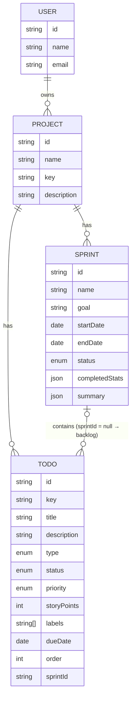

# Kanbot: Implementation Plan (EN)

> How to build the Kanbot frontend in **7 days**: setup, architecture, the **complete backend API**, and a day-by-day plan.
> Read the [requirements](REQUIREMENTS.en.md) first. Requirement IDs (AUTH-1, BL-3, AI-2…) refer to that document.

| | |
|---|---|
| **Frontend (you build it)** | `kanbot/client`: React + TypeScript + Vite |
| **Backend (done, don't change)** | `kanbot/server`: Express 5 + TypeScript on `http://localhost:4000/api` |
| **API contract** | [`server/src/types/api.ts`](../server/src/types/api.ts): copy it to `client/src/types/api.ts` |
| **Demo account** | `demo@kanbot.dev` / `password123` (after `npm run seed`) |

---

## 1. Run the backend

```bash
cd kanbot/server
npm install
cp .env.example .env      # works as-is: the AI runs in mock mode
npm run seed              # demo user + a project with sprints and todos (resets the DB)
npm run dev               # → http://localhost:4000/api/health
npm run smoke             # optional: tests every endpoint on a throwaway DB
```

### 1.1 The AI: mock or real
- **Mock (default).** With `AI_API_KEY` empty, a built-in rule-based assistant answers instantly, for free, offline. Every AI endpoint returns the same JSON shape as with a real model, with `"source": "mock"`. Build the whole app in mock mode.
- **Real.** Put a key from a free provider in `.env`. The backend talks to any OpenAI-compatible API:

  ```env
  AI_API_KEY=<your key>
  AI_BASE_URL=https://openrouter.ai/api/v1     # or Groq / Gemini / Ollama, see .env.example
  AI_MODEL=<model id>
  ```
  Restart the server. `GET /api/ai/status` now returns `{ "mode": "ai", "model": "…" }`.

The data lives in `server/data/db.json` (a JSON file). Delete it or run `npm run seed` to start over.

---

## 2. Tech stack

| Concern | Required | Recommended (you may choose another) |
|---|---|---|
| Framework | React 19 + TypeScript (strict) + Vite | n/a |
| Routing | React Router | n/a |
| Server state | n/a | **TanStack Query**: caching, loading/error states, optimistic updates, invalidation |
| Forms | n/a | **react-hook-form + zod** (`@hookform/resolvers`) |
| Drag and drop | n/a | **dnd-kit** (`@dnd-kit/core`, `@dnd-kit/sortable`): accessible, keyboard support |
| Markdown (AI replies) | n/a | **react-markdown** (raw HTML stays disabled) |
| Dates | n/a | **date-fns** or `Intl.DateTimeFormat` |
| UI library / styling | **Your choice**: there is no design. | e.g. MUI, shadcn/ui + Tailwind, Mantine, Chakra, Ant Design, or plain CSS Modules |
| Icons | Your choice | lucide-react, MUI icons, Tabler… |

Write your choices and the reasons for them in `client/README.md`.

```bash
cd kanbot
npm create vite@latest client -- --template react-ts
cd client
npm i react-router @tanstack/react-query react-hook-form zod @hookform/resolvers \
      @dnd-kit/core @dnd-kit/sortable @dnd-kit/utilities react-markdown date-fns
cp ../server/src/types/api.ts src/types/api.ts
```

Add `VITE_API_URL=http://localhost:4000/api` to `client/.env`.

---

## 3. Frontend architecture

### 3.1 Routes

| Path | Page | Guard |
|---|---|---|
| `/login` | Login | guest only |
| `/register` | Register | guest only |
| `/` | → redirect to `/projects` | private |
| `/projects` | Projects list | private |
| `/projects/:projectId` | → redirect to `backlog` | private |
| `/projects/:projectId/backlog` | Backlog + planned sprints | private |
| `/projects/:projectId/board` | Active sprint board | private |
| `/projects/:projectId/sprints` | Sprints history | private |
| `/projects/:projectId/sprints/:sprintId` | Sprint details + summary | private |
| `*` | Not found | n/a |

Use one layout route for private pages (`<ProtectedRoute>` → `<AppShell>` with sidebar + top bar + AI drawer) and one for guest pages (`<GuestRoute>`).

### 3.2 Folder structure (suggested)

```
client/src/
├── main.tsx                 # providers: QueryClient, Router, Auth, Theme, Toasts
├── router.tsx               # route table (§3.1)
├── types/api.ts             # copied from the server — never edit by hand
├── api/
│   ├── client.ts            # fetch wrapper: base URL, token, JSON, ApiError, 401 handling
│   ├── auth.ts              # register(), login(), me()
│   ├── projects.ts          # listProjects(), createProject()...
│   ├── todos.ts
│   ├── sprints.ts
│   └── ai.ts
├── hooks/                   # TanStack Query hooks: useProjects(), useBacklog(), useMoveTodo()...
├── features/
│   ├── auth/                # LoginPage, RegisterPage, AuthProvider, ProtectedRoute, GuestRoute
│   ├── projects/            # ProjectsPage, ProjectFormDialog, ProjectSwitcher
│   ├── backlog/             # BacklogPage, TodoRow, QuickCreate, SprintSection, Filters
│   ├── board/               # BoardPage, Column, TodoCard, SprintProgress, CompleteSprintDialog
│   ├── sprints/             # SprintsPage, SprintDetails, StartSprintDialog, SprintFormDialog
│   ├── todos/               # TodoDetailsDialog, PriorityBadge, PointsSelect, TypeIcon
│   └── ai/                  # AssistantDrawer, ChatMessages, GenerateTodosDialog, PlanSprintDialog, SprintSummary
├── components/              # your design-system pieces: Button, Dialog, EmptyState, ErrorState, ConfirmDialog...
└── lib/                     # formatDate(), cn(), constants (labels for statuses/priorities)
```

### 3.3 API client and errors
One `request<T>(method, path, body?)` function used by every `api/*.ts` file:
1. Prefix `import.meta.env.VITE_API_URL`, add `Content-Type: application/json` and `Authorization: Bearer <token>` when there is a token.
2. `204` → return `undefined`.
3. Non-2xx → throw an `ApiError` class with `status`, `code`, `message`, `details` from the `ApiErrorBody`.
4. `401` on any path except `/auth/login` → call an `onUnauthorized()` callback registered by the AuthProvider (clear session, redirect to `/login?redirect=…`, show "session expired") (AUTH-6).
5. Network failure → throw an `ApiError` with code `NETWORK_ERROR` and message "Cannot reach the server. Is it running?".

Helper: `fieldErrors(err)` maps `details[]` to `{ [field]: message }` so forms can call `setError` per field.

### 3.4 State rules
- **Server data lives only in TanStack Query** (no copies in `useState`/context). The token and user live in the AuthProvider (+ `localStorage` for the token).
- Query keys:
  `['projects']`, `['project', id]`, `['todos', projectId, filters]`, `['board', sprintId]`, `['sprints', projectId]`, `['sprint', sprintId]`, `['ai-status']`.
- After a mutation, **invalidate** what changed. For example, completing a sprint invalidates `['sprints', projectId]`, `['board', sprintId]`, `['todos', projectId]` and `['project', projectId]`.
- **Optimistic updates** for move/reorder (BL-5, SPR-5): in `onMutate`, cancel queries, snapshot, update the cache; in `onError`, restore the snapshot and show a toast; in `onSettled`, invalidate.
- UI-only state (dialog open, chat messages, filters) stays in components or a small context. Filters may live in the URL (`?q=&priority=`).
- On logout: `queryClient.clear()`.

### 3.5 Drag-and-drop model
- The backlog is **one list**. Each planned sprint is a list. The board has **one list per status**.
- After a drop, call `POST /todos/:id/move` with `{ sprintId?, status?, position }`. `position` is the **index in the target list after removing the dragged todo** (0 = top). The server renumbers `order` for you. Never compute `order` yourself.
- Optimistic UI: remove the todo from the source array in the cache and insert it at `position` in the target array.

---

## 4. Backend API design

Base URL `http://localhost:4000/api`. JSON in and out. All routes except `health`, `auth/register` and `auth/login` require `Authorization: Bearer <token>`. Users can only access their own data. Another user's ids return **404**, never 403.

### 4.1 Data model



**Enums**

| Field | Values |
|---|---|
| `Todo.status` | `todo` · `in_progress` · `in_review` · `done` (board column order) |
| `Todo.priority` | `low` · `medium` · `high` · `urgent` |
| `Todo.type` | `task` · `story` · `bug` |
| `Todo.storyPoints` | `1` · `2` · `3` · `5` · `8` · `13` · `null` |
| `Sprint.status` | `planned` → `active` → `completed` |

**Business rules**
- A todo with `sprintId: null` is in the **backlog**. `key` (`KAN-12`) is assigned at creation and never changes.
- `order` is the position inside its list: the backlog, or *one status column of one sprint*. Lists are returned sorted.
- `completedAt` is set when status becomes `done` and cleared when it leaves `done`.
- At most **one active sprint** per project. Only **planned** sprints can be started, edited freely or deleted (deleting returns their todos to the backlog).
- Completing a sprint: done todos stay in it (history). Unfinished todos move to the backlog or a planned sprint, keeping their status. A snapshot is saved in `completedStats` (with `carriedOver`). Todos of a completed sprint cannot be moved (409).
- Todos can't be added to a completed sprint (409).
- `Sprint.stats` is always live (computed from the todos currently in it). For completed sprints, show `completedStats`.

### 4.2 Errors

```json
{ "error": { "code": "VALIDATION_ERROR", "message": "email: Enter a valid email address",
             "details": [{ "path": "email", "message": "Enter a valid email address" }] } }
```

| Status | `code` | When | UI behaviour |
|---|---|---|---|
| 400 | `VALIDATION_ERROR` | Invalid body/query. `details[].path` = field name | Show under fields; else toast `message` |
| 401 | `UNAUTHORIZED` | Missing/expired token; wrong credentials on login | Login: show message. Elsewhere: session expired flow |
| 404 | `NOT_FOUND` | Unknown route or id, or not yours | Not-found state |
| 409 | `CONFLICT` | Email taken, key taken, sprint already active, completed sprint… | Show `message` |
| 429 | `RATE_LIMITED` | Auth: 50 / 15 min. AI: 20 / min per user | Show `message`, allow retry later |
| 502 | `AI_ERROR` | AI provider failed / bad answer / timeout | Show `message` + "Try again" |
| 500 | `INTERNAL_ERROR` | Bug | Generic error |

### 4.3 Endpoint summary

| Method | Path | Body → Response | Req. |
|---|---|---|---|
| GET | `/health` | → `HealthResponse` | n/a |
| **Auth** |||
| POST | `/auth/register` | `RegisterRequest` → **201** `AuthResponse` | AUTH-1 |
| POST | `/auth/login` | `LoginRequest` → `AuthResponse` | AUTH-2 |
| GET | `/auth/me` | → `{ user }` | AUTH-3 |
| **Projects** |||
| GET | `/projects` | → `{ projects: ProjectWithStats[] }` (recently updated first) | PRJ-1 |
| POST | `/projects` | `CreateProjectRequest` → **201** `{ project }` | PRJ-2 |
| GET | `/projects/:projectId` | → `{ project: ProjectWithStats }` | PRJ-5 |
| PATCH | `/projects/:projectId` | `UpdateProjectRequest` → `{ project }` | PRJ-3 |
| DELETE | `/projects/:projectId` | → **204** (deletes its sprints and todos) | PRJ-4 |
| **Todos** |||
| GET | `/projects/:projectId/todos?sprintId=&status=&priority=&type=&search=` | → `{ todos }` | BL-1, BL-6 |
| POST | `/projects/:projectId/todos` | `CreateTodoRequest` → **201** `{ todo }` | BL-2 |
| POST | `/projects/:projectId/todos/bulk` | `{ todos: CreateTodoRequest[] }` → **201** `{ todos }` | AI-2 |
| GET | `/todos/:todoId` | → `{ todo }` | BL-3 |
| PATCH | `/todos/:todoId` | `UpdateTodoRequest` → `{ todo }` | BL-3, BL-7 |
| POST | `/todos/:todoId/move` | `MoveTodoRequest` → `{ todo }` | BL-5, SPR-5 |
| DELETE | `/todos/:todoId` | → **204** | BL-4 |
| **Sprints** |||
| GET | `/projects/:projectId/sprints` | → `{ sprints }` (active, planned, then completed newest first) | SPR-7 |
| POST | `/projects/:projectId/sprints` | `CreateSprintRequest` → **201** `{ sprint }` | SPR-1, AI-3 |
| GET | `/sprints/:sprintId` | → `{ sprint }` | SPR-7 |
| GET | `/sprints/:sprintId/todos` | → `SprintBoardResponse` `{ sprint, columns }` | SPR-4 |
| PATCH | `/sprints/:sprintId` | `UpdateSprintRequest` → `{ sprint }` | SPR-2 |
| DELETE | `/sprints/:sprintId` | → **204** (planned only) | SPR-2 |
| POST | `/sprints/:sprintId/start` | `StartSprintRequest` → `{ sprint }` | SPR-3 |
| POST | `/sprints/:sprintId/complete` | `CompleteSprintRequest` → `{ sprint }` | SPR-6 |
| **AI** |||
| GET | `/ai/status` | → `{ mode: 'mock' \| 'ai', model }` | AI-5 |
| POST | `/projects/:projectId/ai/chat` | `ChatRequest` → `ChatResponse` | AI-1 |
| POST | `/projects/:projectId/ai/generate-todos` | `GenerateTodosRequest` → `GenerateTodosResponse` | AI-2 |
| POST | `/projects/:projectId/ai/plan-sprint` | `PlanSprintRequest` → `PlanSprintResponse` | AI-3 |
| POST | `/sprints/:sprintId/ai/summary` | → `SprintSummaryResponse` (saved on the sprint) | AI-4 |

### 4.4 Endpoint details and examples

#### Auth
```http
POST /api/auth/register
{ "name": "Sara", "email": "sara@example.com", "password": "password123" }

201 { "token": "eyJhbGciOi…", "user": { "id": "…", "name": "Sara", "email": "sara@example.com", "createdAt": "…" } }
409 { "error": { "code": "CONFLICT", "message": "An account with this email already exists.",
                 "details": [{ "path": "email", "message": "An account with this email already exists." }] } }
```
`POST /auth/login` returns the same body with 200, or 401 `"Incorrect email or password."`. `GET /auth/me` returns `{ "user": … }`. Tokens last 7 days. Logging out is client-side only (forget the token).

#### Projects
```http
POST /api/projects
{ "name": "Mobile App Redesign", "description": "New look" }       // key optional → "MAR"

201 { "project": { "id": "…", "name": "Mobile App Redesign", "key": "MAR", "description": "New look",
      "createdAt": "…", "updatedAt": "…",
      "stats": { "backlogCount": 0, "totalTodos": 0, "activeSprint": null } } }
```
`key`: 2–6 letters, uppercased by the server, unique per user (409 with `details[0].path = "key"`).

#### Todos
```http
POST /api/projects/:projectId/todos
{ "title": "Login screen", "priority": "high", "storyPoints": 3 }

201 { "todo": { "id": "…", "projectId": "…", "sprintId": null, "key": "MAR-1", "title": "Login screen",
      "description": "", "type": "task", "status": "todo", "priority": "high", "storyPoints": 3,
      "labels": [], "dueDate": null, "order": 0, "createdAt": "…", "updatedAt": "…", "completedAt": null } }
```
Defaults: `type: task`, `status: todo`, `priority: medium`, `storyPoints: null`, `sprintId: null`. New todos go to the **end** of their list.

**List / filter**: `GET /projects/:id/todos?sprintId=backlog` returns the backlog sorted by `order`. `sprintId=<id>` returns one sprint. Add `search`, `priority`, `type`, `status` as needed.

**Update**: `PATCH /todos/:id` with any subset of fields. If `sprintId` or `status` (inside a sprint) changes, the todo is appended to the end of the new list.

**Move (drag and drop)**:
```http
POST /api/todos/:todoId/move
{ "status": "in_progress", "position": 0 }                    // board: to top of "In Progress"
{ "position": 3 }                                             // backlog: reorder
{ "sprintId": "<sprint id>", "status": "todo", "position": 0 } // backlog → sprint
{ "sprintId": null, "position": 0 }                           // sprint → top of backlog
```

#### Sprints
```http
POST /api/projects/:projectId/sprints
{ "goal": "Auth flow", "todoIds": ["<backlog todo id>", "…"] }  // all fields optional

201 { "sprint": { "id": "…", "projectId": "…", "name": "Sprint 1", "goal": "Auth flow",
      "startDate": null, "endDate": null, "status": "planned", "startedAt": null, "completedAt": null,
      "completedStats": null, "summary": null,
      "stats": { "totalTodos": 2, "doneTodos": 0, "totalPoints": 8, "donePoints": 0,
                 "byStatus": { "todo": 2, "in_progress": 0, "in_review": 0, "done": 0 } },
      "createdAt": "…", "updatedAt": "…" } }
```
`todoIds` must all be backlog todos of the project (400 otherwise).

```http
POST /api/sprints/:id/start      { "startDate": "2026-11-02", "endDate": "2026-11-16" }  // both optional
POST /api/sprints/:id/complete   { "moveUnfinishedTo": "backlog" }   // or a planned sprint id
GET  /api/sprints/:id/todos      → { "sprint": {…}, "columns": { "todo": [], "in_progress": [], "in_review": [], "done": [] } }
```
After `complete`, `sprint.completedStats` = `{ totalTodos, doneTodos, totalPoints, donePoints, byStatus, carriedOver }`.

#### AI
All AI endpoints are normal request/response (no streaming), take 1–10 s with a real model (instant in mock mode), and include `"source": "mock" | "ai"`.

```http
POST /api/projects/:projectId/ai/generate-todos
{ "prompt": "User profile page with avatar upload", "count": 5 }

200 { "source": "ai", "todos": [
  { "title": "Design the profile page layout", "description": "…", "type": "task", "priority": "high", "storyPoints": 2 },
  … ] }
```
Nothing is saved. Save the ones the user keeps with `POST /projects/:id/todos/bulk`. (Mock tip: a prompt with one item per line becomes one todo per line.)

```http
POST /api/projects/:projectId/ai/plan-sprint
{ "capacity": 20, "focus": "AI features" }

200 { "source": "mock", "goal": "AI features", "todoIds": ["…", "…"], "totalPoints": 18,
      "reasoning": "Picked 5 todos (2 high, 3 medium) by priority and focus, bugs first, for 18 of 20 points." }
```
The server guarantees that `todoIds` are real backlog ids and that `totalPoints ≤ capacity`. Show the matching todos from your backlog cache. Create the sprint with `POST /projects/:id/sprints { goal, todoIds }`.

```http
POST /api/sprints/:sprintId/ai/summary          // active or completed sprint (planned → 409)
200 { "sprint": { …, "summary": { "content": "## Sprint 1 summary …", "source": "ai", "generatedAt": "…" } },
      "summary": { "content": "…markdown…", "source": "ai", "generatedAt": "…" } }
```

```http
POST /api/projects/:projectId/ai/chat
{ "messages": [
  { "role": "user", "content": "How is the sprint going?" },
  { "role": "assistant", "content": "…" },
  { "role": "user", "content": "What should I do next?" } ] }      // 1–30 messages, last one from the user

200 { "message": { "role": "assistant", "content": "…markdown…" }, "source": "ai" }
```
The server has no chat memory: keep the messages in the frontend and send the whole list each time. The server adds the project's backlog and active sprint as context for the model.

---

## 5. Day-by-day plan

Each day ends with a **working app**. Commit at least once per day. Day 7 is buffer and polish. Don't start AI features before the core flow works.

### Day 1: Setup, design direction, auth
- Create `client`, install packages, copy `api.ts`, set up ESLint/Prettier, `VITE_API_URL`.
- **Pick your UI library and design direction**: colours, font, radius, spacing. Note it in the README. Build the base components you'll need (Button, Input, Dialog, EmptyState, Spinner, Toast).
- `api/client.ts` with `ApiError` and 401 handling. `AuthProvider` (token + user, `login`, `register`, `logout`, startup `/auth/me`).
- Router with `ProtectedRoute` / `GuestRoute`, Login and Register pages with validation and server errors.
- **Done when:** AUTH-1…6 pass. A reload keeps you logged in. Deleting the token in DevTools and clicking anything sends you to login.

### Day 2: App shell and projects
- `AppShell`: sidebar (logo, project switcher, nav Backlog / Board / Sprints, user + logout), top bar with page title and "Ask AI" button (opens an empty drawer for now).
- Projects page: list, empty state, create/edit dialog (with 409 on key), delete with confirm.
- **Done when:** PRJ-1…5 pass. Navigating between projects updates the URL and the sidebar.

### Day 3: Backlog and todo details
- Backlog list (`?sprintId=backlog`), header totals, quick create (BL-2), empty state.
- `TodoDetailsDialog` for edit and delete (BL-3, BL-4), with shared `PriorityBadge`, `TypeIcon`, `PointsSelect`.
- Search (debounced) + priority/type filters (BL-6).
- **Done when:** BL-1…4 and BL-6 pass with the seeded demo data.

### Day 4: Sprints planning and drag and drop
- Planned sprint sections above the backlog (SPR-1). Create/edit/delete sprint dialogs (SPR-2).
- Drag and drop reorder in the backlog and between backlog ↔ planned sprint, with optimistic updates (BL-5, BL-7). Menu alternative ("Move to Sprint 3", "Move to top").
- Start sprint dialog (SPR-3).
- **Done when:** you can plan a sprint by hand and start it. A failed move (stop the server) rolls back with a toast.

### Day 5: Board, complete sprint, history
- Board page (`GET /sprints/:id/todos`): header with goal, dates, days left, progress (SPR-4). Columns with drag and drop between and within columns (SPR-5).
- Complete sprint dialog (SPR-6).
- Sprints history and sprint details page with stats tiles (SPR-7).
- **Done when:** the full manual sprint cycle works: plan → start → move cards → complete → see history.

### Day 6: AI assistant
- `GET /ai/status` → "Mock AI" badge. Assistant drawer with chat (AI-1) rendering Markdown.
- Generate todos dialog with editable drafts + bulk save (AI-2).
- Plan sprint dialog → create sprint with suggested todos (AI-3).
- Summary on the board and on completed sprints, saved + regenerate (AI-4).
- Loading, error and retry states everywhere (AI-5). Test once with a real key if you have one.
- **Done when:** AI-1…5 pass in mock mode.

### Day 7: Polish and delivery
- Go through NFR-1…9: loading/empty/error states, keyboard, focus, responsive (1024 / 768), toasts.
- Fix bugs. Run `npm run lint` and `npm run build` with no errors.
- README (setup, design choices, done/not done, enhancements), record the demo.
- Optional: enhancements from requirements §9.

---

## 6. QA checklist (run before delivering)

- [ ] Register with an existing email → error under email. Wrong password → message above the form.
- [ ] Reload on `/projects/:id/board` → still there. Remove the token → back to login with `?redirect=` → log in → back on the board.
- [ ] Create a project without a key → key generated. Same key twice → 409 shown on the field.
- [ ] Quick-create 3 todos with Enter. Edit one (all fields). Delete one.
- [ ] Reorder the backlog by drag **and** by keyboard/menu. Reload → order kept.
- [ ] Create a sprint, move todos into it, start it. Try to start a second sprint → explained.
- [ ] Drag cards across all columns. Progress bar updates. Stop the server and drag → rollback + toast.
- [ ] Complete the sprint, sending unfinished todos to a planned sprint → they appear there with their status.
- [ ] Generate 5 todos with AI, uncheck 2, edit 1, save 3 → exactly those 3 in the backlog.
- [ ] Plan a sprint with capacity 10 → total ≤ 10 → create sprint → appears as planned.
- [ ] Summarize the active sprint. Reload → summary still there. Regenerate.
- [ ] Chat: 3 messages back and forth. Markdown renders. Switch project → chat resets.
- [ ] With a real key and a wrong model name → the 502 message shows with "Try again".
- [ ] Keyboard only: log in, open a todo, save, close the dialog with Esc.
- [ ] Width 768px: sidebar collapses, the board scrolls horizontally.
- [ ] `npm run lint` and `npm run build` are clean. No errors in the console.

---

## 7. Working with an AI coding assistant (optional)

You may use AI tools, but you must understand and be able to explain every line. A good prompt per step:

```text
You are a senior React + TypeScript engineer. Read kanbot/docs/REQUIREMENTS.en.md and
kanbot/docs/IMPLEMENTATION-PLAN.en.md. Implement Day <N> only.
Rules: don't modify kanbot/server; use client/src/types/api.ts; follow §3 (structure, state rules);
use my UI library <X> and my design tokens in <file>. When done, run lint + build, fix errors,
then list each acceptance criterion of Day <N> and whether it passes.
```
